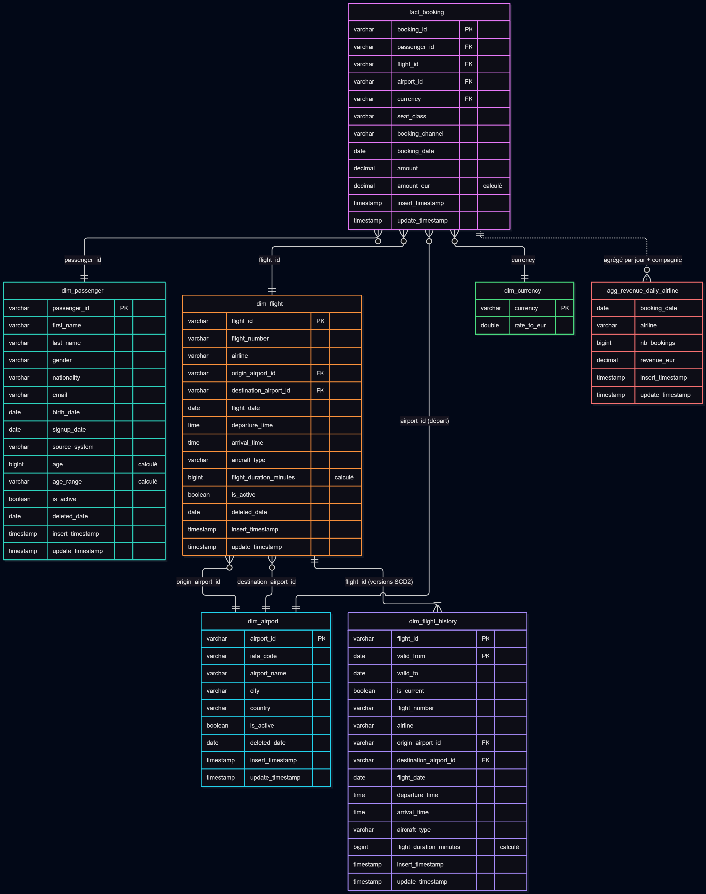
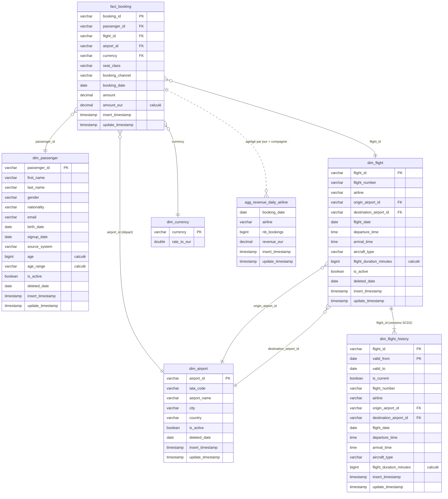

# Documentation — choix de modélisation

**Auteur :** Tom Labourel (TP réalisé seul)

## Lancer le pipeline

```bash
python3 -m venv venv && source venv/bin/activate
pip install -r requirements.txt
python ingestion/run_month.py 
```

Ou avec Dagster (bonus, cf. section 6) : `dagster dev -f ingestion/dagster_defs.py -d ingestion`.

## 1. Ce que l'exploration a montré

| Fichier source | Clé | Contenu d'un fichier journalier | Évolution observée | Nature |
|---|---|---|---|---|
| `airports` | `airport_id` | snapshot complet | quasi figé (1 modif, 1 ajout sur le mois) | dimension |
| `flights` | `flight_id` | snapshot complet | 0 à 5 changements/jour : ajouts, modifs (horaire, avion, date), disparitions | dimension |
| `passengers_en` / `passengers_fr` | `passenger_id` / `id_passager` | snapshot complet | ajouts quotidiens, corrections, rares disparitions | dimension |
| `bookings` | `booking_id` | **uniquement les réservations du jour** | une réservation ne change jamais | **fait** |

**Fait vs dimensions.** Une réservation est un **évènement** : elle a lieu à une date, porte une mesure
(le montant) et ne change plus ensuite. C'est donc la table de fait. Les aéroports, vols et passagers
sont du **contexte** qui décrit ces évènements et qui évolue dans le temps : ce sont des dimensions.

## 2. Architecture médaillon

- **Bronze** (`bronze/`, fichiers CSV) : chaque fichier source est téléchargé une seule fois puis relu
  depuis le disque (`fetch_csv`). C'est notre copie locale, qui permet de tout rejouer sans la source.
- **Silver** (DuckDB, `silver_*`) : une table par entité, typée (vraies `DATE`, `TIME`, `DECIMAL`) et
  au schéma unique.
- **Gold** (DuckDB) : schéma en étoile `fact_booking` + dimensions, une table d'agrégation, et
  `dim_flight_history`, l'historique complet des vols (bonus SCD2, cf. section 5).

Chaque entité a un script avec 3 fonctions (`ingest_bronze`, `ingest_silver`, `ingest_gold`). Chaque
fonction ne lit que ce que la précédente a persisté (fichier bronze, puis table silver).

## 3. Stratégies de chargement (silver)

| Table | Stratégie | Pourquoi |
|---|---|---|
| `silver_airports`, `silver_flights`, `silver_passengers` | **Upsert** (`INSERT ... ON CONFLICT DO UPDATE`) **+ désactivation** | Le fichier du jour est l'état complet de la source : une clé nouvelle est insérée, une clé connue est mise à jour, une clé **absente** a été supprimée à la source. |
| `silver_bookings` | **Insert simple** (`INSERT ... ON CONFLICT DO NOTHING`) | Le fichier ne contient que les nouveautés du jour, et une réservation ne change jamais. Une clé absente ne veut rien dire (elle a été réservée un autre jour), donc pas de désactivation. |
| `silver_flights_history` (bonus) | **SCD2** : fermeture de la version en cours + insertion d'une nouvelle version | On veut garder chaque version d'un vol, pas seulement la dernière (cf. section 5). |

**Suppressions.** On ne supprime jamais physiquement une ligne de dimension : des réservations déjà
faites la référencent, la supprimer casserait l'intégrité du modèle. La ligne passe à
`is_active = false` et `deleted_date` prend la date du jour où sa disparition est constatée. Si la clé réapparaît, l'upsert la réactive (`is_active = true`, `deleted_date = NULL`).

**Idempotence.** Rejouer un jour déjà chargé ne crée ni doublon ni erreur : `ON CONFLICT` sur la clé
primaire, et le gold est reconstruit entièrement (`CREATE OR REPLACE`). Vérifié en rejouant tout le
mois deux fois : contenu identique.

**Colonnes techniques.** Comme vu en cours, nous intégrons des colonnes techniques, essentielles pour le jeu de données, sur toutes les tables silver et gold : `insert_timestamp` (première
apparition, jamais modifié) et `update_timestamp` (rafraîchi à chaque upsert ou désactivation).

**Consolidation des passagers.** Nous avions des passagers avec des colonnes différentes selon la nationalité. Nous avons donc, via un `UNION ALL`, harmoniser vers un seul schéma (écrit en langue anglaise) :

| | EN | FR | Silver |
|---|---|---|---|
| Colonnes | `passenger_id`, `first_name`… | `id_passager`, `prenom`… | noms anglais |
| Genre | `Male` / `Female` | `Homme` / `Femme` | `Male` / `Female` |
| Dates | `YYYY-MM-DD` | `DD/MM/YYYY` (`strptime`) | `DATE` |

Les identifiants ne se chevauchent pas entre les deux sources, donc pas de dédoublonnage. Une colonne
`source_system` (`en` / `fr`) garde la trace du CRM d'origine pour tout de même conserver la provenance du passager. Un
passager est désactivé s'il est absent **des deux** fichiers du jour.

## 4. Modèle gold (schéma en étoile) - Fait à l'aide de Claude



Source du diagramme (Mermaid, aussi dans `docs/data_model.mmd`) :



**Attributs calculés :**

- `dim_flight.flight_duration_minutes` = arrivée − départ en minutes. Si l'arrivée est avant le départ,
  le vol arrive le lendemain (ex. 15:30 → 03:41) : on ajoute 1440 min (24 h).
- `dim_passenger.age` = âge exact à la date d'exécution (`age(current_date, birth_date)`, qui tient
  compte de l'anniversaire) ; `age_range` = tranches `18-24`, `25-34`, `35-44`, `45-54`, `55-64`, `65+`
  (et `0-17` par sécurité, aucun passager mineur dans les données).
- `fact_booking.amount_eur` = `amount * dim_currency.rate_to_eur`, en `DECIMAL(12, 2)`. `LEFT JOIN` sur
  `dim_currency` : une devise inconnue donnerait `amount_eur = NULL` au lieu de faire disparaître la
  réservation.

Les montants sont en `DECIMAL` et non en `DOUBLE` pour rester exacts au centime.

**Table d'agrégation `agg_revenue_daily_airline`** : Chiffre d'affaires en euros et nombre de réservations par jour de
réservation et par compagnie (la compagnie vient de `dim_flight` via `flight_id`). Elle est construite
par `ingestion/build_aggregates.py`, **une seule fois après la boucle quotidienne** de `run_month.py`
plutôt que dans l'`ingest_gold` d'une entité : elle dépend de plusieurs tables gold (`fact_booking` et
`dim_flight`) et se reconstruit entièrement à partir du gold, inutile de la recalculer chaque jour.

## 5. Bonus : SCD2

**Pourquoi les vols ?** C'est la dimension qui change le plus (horaire, avion, date modifiés presque
chaque jour). Avec le seul upsert (SCD1), l'ancienne valeur est écrasée : impossible de savoir quel avion
était prévu sur un vol à une date passée.

**Principe.** `silver_flights_history` garde **toutes les versions** de chaque vol, avec leur période de
validité : `valid_from` (inclus) → `valid_to` (exclu, `NULL` = version en cours), et `is_current`.
Clé primaire : `(flight_id, valid_from)`.

| flight_id | aircraft_type | valid_from | valid_to | is_current |
|---|---|---|---|---|
| F0141 | Airbus A321 | 2025-08-31 | 2025-09-08 | false |
| F0141 | Airbus A330 | 2025-09-08 | NULL | true |

**Chargement** (`load_history`, appelée dans `ingest_silver` sur le même snapshot) :

1. **Fermer** les versions en cours qui ne sont plus vraies : vol absent du snapshot, ou au moins une
   valeur différente (`valid_to = jour`, `is_current = false`). La comparaison utilise
   `IS NOT DISTINCT FROM`, qui traite correctement les `NULL`.
2. **Ouvrir** une nouvelle version pour chaque vol du snapshot sans version en cours (nouveau vol, ou
   version fermée à l'étape 1).
3. **Rejouabilité** : avant tout, ce qu'un éventuel chargement précédent du même jour (ou des jours
   suivants) avait produit est annulé (versions créées à partir de ce jour supprimées, versions fermées
   à partir de ce jour rouvertes), puis le jour est rechargé. Relancer un jour ne crée donc pas de doublon.

**Pourquoi une table à côté plutôt que remplacer `dim_flight` ?** Dans l'historique, un `flight_id`
apparaît plusieurs fois : joindre `fact_booking` dessus sur le seul `flight_id` dupliquerait les
réservations. `dim_flight` (SCD1, une ligne par vol) reste donc la dimension du schéma en étoile, et
`dim_flight_history` sert aux questions « à une date donnée » :

```sql
-- Quel avion était affecté au vol F0141 le 5 septembre 2025 ?  -> Airbus A321 (A330 à partir du 8)
SELECT aircraft_type FROM dim_flight_history
WHERE flight_id = 'F0141'
  AND valid_from <= DATE '2025-09-05'
  AND (valid_to > DATE '2025-09-05' OR valid_to IS NULL);
```

## 6. Bonus : orchestration avec Dagster

`ingestion/dagster_defs.py` remplace `run_month.py`. Les fonctions des scripts d'ingestion ne changent
pas : chacune est « emballée » dans un **asset** Dagster (une fonction ≈ un asset).

| Asset | Partitionné ? | Appelle |
|---|---|---|
| `init_load` | non | `dim_currency.sql` + `ingest_bronze/ingest_silver(init=True)` des 4 entités |
| `bronze_<entité>` (×4) | **oui, 1 partition par jour** (1 → 30 septembre) | `ingest_bronze(jour)` |
| `silver_<entité>` (×4) | **oui, 1 partition par jour** | `ingest_silver(jour)` |
| `dim_airport`, `dim_flight`, `dim_passenger`, `fact_booking` | non | `ingest_gold()` |
| `agg_revenue_daily_airline` | non | `build_aggregates` |

**Dépendances.** Elles sont déclarées dans le code (`deps=`), Dagster en déduit l'ordre et les dessine :
`bronze → silver → gold → agrégat`, `init_load` avant les silver quotidiens et avant `fact_booking`
(qui a besoin de `dim_currency`), et l'agrégat après `fact_booking` et `dim_flight`. Le gold n'est pas
partitionné car il ne dépend que de l'état courant du silver, pas d'une date.

**Deux choix liés à DuckDB et au silver :**

- **`BackfillPolicy.single_run()`** : un backfill de 30 jours s'exécute en **un seul run** qui reçoit
  toute la plage de dates et la traite **dans l'ordre**. Avec 30 runs séparés, Dagster pourrait les
  lancer en parallèle ou dans le désordre, or le silver compare chaque jour à l'état de la veille
  (désactivations, SCD2).
- **`in_process_executor`** : les assets d'un run s'exécutent l'un après l'autre dans un seul processus,
  car DuckDB n'accepte qu'un processus en écriture à la fois sur `warehouse.duckdb`.

**Lancer :**

```bash
pip install -r requirements-dagster.txt
dagster dev -f ingestion/dagster_defs.py -d ingestion    # -d : dossier des scripts importés
```

Puis, sur http://localhost:3000 (onglet *Assets*) :

1. Matérialiser `init_load`.
2. Sélectionner les 8 assets `bronze_*` et `silver_*` → *Materialize* → toutes les partitions
   (`2025-09-01` … `2025-09-30`) : c'est le **backfill** qui remplace la boucle de `run_month.py`.
3. Matérialiser les 5 assets du groupe `gold`.

**Vérification.** Les 11 tables produites par Dagster (silver, gold, historique SCD2, agrégat) sont
identiques ligne à ligne à celles produites par `run_month.py` (hors colonnes de timestamp).

## 7. Limites connues

- **Historique uniquement sur les vols** : aéroports et passagers restent en SCD1 (l'upsert écrase
  l'ancienne valeur). La même logique SCD2 pourrait leur être appliquée.
- **`update_timestamp` rafraîchi à chaque passage**, même sans vrai changement de valeur (pattern du
  modèle `ingest_airports.py`) : il ne permet pas de dater précisément une modification.
- **Durée de vol** : on suppose que départ et arrivée sont dans le même fuseau horaire et qu'aucun vol ne dépasse 24 h.
- **Âge calculé à la date d'exécution** : il change d'un jour à l'autre ; l'âge au moment de la réservation n'est pas stocké.
- **Taux de change fixes** (`dim_currency`) : pas d'évolution des taux dans le temps.
- **Dagster ne suit pas la fraîcheur du gold** : après un nouveau backfill du silver, il faut
  rematérialiser le groupe `gold` à la main (pas de déclenchement automatique configuré).
